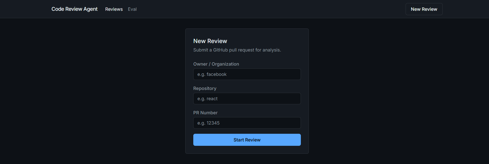
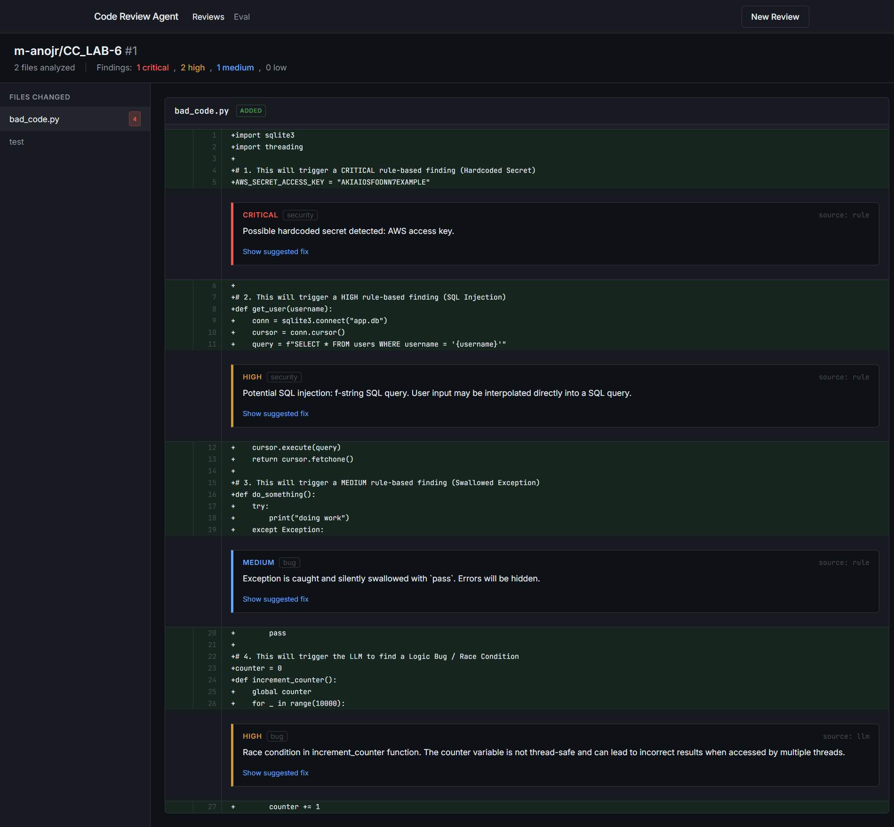
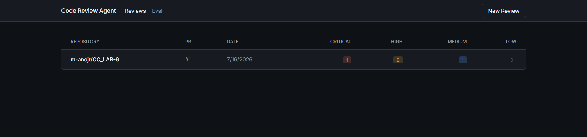
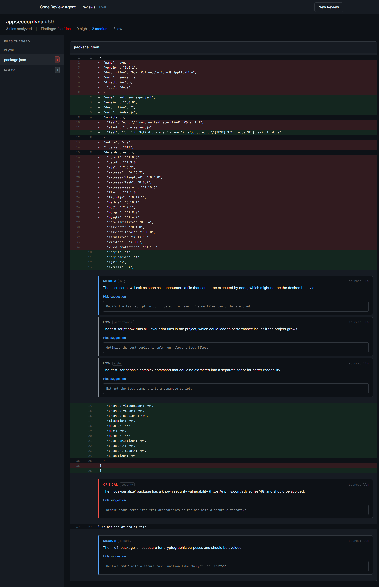
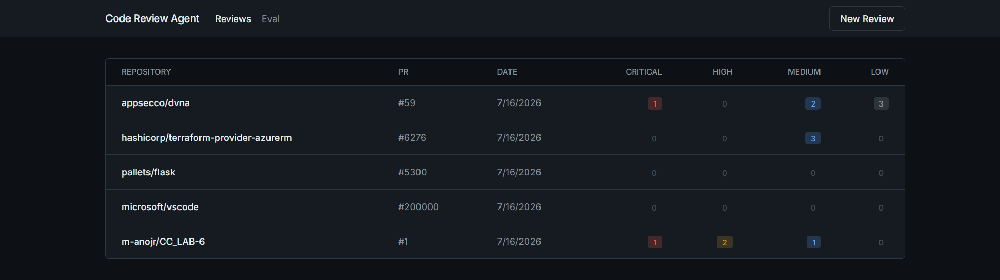
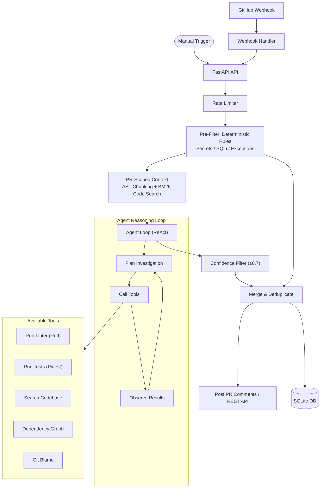

# Review Studio

A local-first code review workspace for GitHub pull requests. Deterministic security checks run alongside an AI agent that can investigate changes with repository tools, then findings are presented in context against the original diff.

## Screenshots

| Submit New Review | Code Diff Viewer |
| :---: | :---: |
|  |  |
| **Evaluation Suite** | **Inline AI Findings** |
|  |  |

<br>
<p align="center">
  <b>Reviews Dashboard</b><br>
  
</p>

## Architecture



## Key Features

- **Agentic, not single-shot**: The AI agent plans its investigation, calls tools, and iterates before producing findings
- **Language support**: AI can read any textual GitHub diff; Python gets AST chunking and Python-specific lint/dependency/test tools. Other languages use line-based context, not language-specific AST analysis.
- **PR-aware context**: AST-aware chunks and BM25 identifier search across changed files help the agent check call sites without mixing code from other reviews
- **Precision-first**: Confidence threshold (default 0.7) drops low-confidence findings — false positives destroy trust
- **Tool-augmented**: Linter, test runner, dependency graph, codebase search, git blame
- **Review workspace**: Search history, filter by severity, compare review findings, and inspect inline diff annotations
- **Operational feedback**: API availability indicator, recoverable loading and error states, and clear guidance when a review cannot start
- **Safer inputs**: Validate GitHub repository coordinates and avoid returning raw upstream exception details to the browser
- **GitHub webhook integration**: Auto-triggers on PR open/update with HMAC signature verification
- **Deterministic pre-filter**: Regex rules for secrets, SQL injection, and exceptions run before the agent (fast, free, 100% precision)
- **Production guardrails**: Rate limiting, cost tracking, prompt injection defense, secret leak prevention, silent failure monitoring

## Tech Stack

| Component | Technology | Why |
|-----------|-----------|-----|
| Backend | FastAPI + Python | Async-native, fast, great ecosystem |
| Agent LLM | Groq (Llama 3.3 70B) | Free tier, fastest inference, tool-use support |
| Fallback LLM | Gemini 2.0 Flash | Google's free tier as backup |
| Review context | Request-scoped code search | No cross-review index or model download |
| Frontend | React + Vite + Tailwind | Modern, fast dev experience |
| Database | SQLite (aiosqlite) | Zero-config, sufficient for single-instance |
| Local development | Python + Node.js | Runs directly on your machine |

## Setup and Running

Run the backend and frontend directly on your machine. You need Python 3.11 and Node.js 20 or newer.

1. Copy `.env.example` to `.env` in the repository root and add the keys you use:
   - `GITHUB_TOKEN`: GitHub token with read access to target repos
   - `GROQ_API_KEY`: Primary LLM provider key from [console.groq.com](https://console.groq.com)
   - `GEMINI_API_KEY`: Optional fallback provider key
   - `GITHUB_WEBHOOK_SECRET`: Optional; only needed for webhook integration
   In PowerShell, the copy command is `Copy-Item .env.example .env`.
2. In a PowerShell terminal at the repository root, create the Python environment and install backend dependencies:

```powershell
py -3.11 -m venv .venv
.\.venv\Scripts\Activate.ps1
python -m pip install -r backend\requirements.txt
```

3. Start the backend in that terminal:

```powershell
python -m uvicorn app.main:app --app-dir backend --reload --host 127.0.0.1 --port 8000
```

4. In a second terminal, install and start the frontend:

```powershell
cd frontend
npm install
npm run dev
```

5. Open `http://localhost:3000`. The frontend forwards `/api` requests to the local backend on port 8000. The backend creates its SQLite database as `reviews.db` in the repository root. Interactive API documentation is available at `http://localhost:8000/docs`.

## Agent Configuration

| Variable | Default | Description |
|----------|---------|-------------|
| `AGENT_MAX_ITERATIONS` | 5 | Max ReAct loop iterations per file |
| `AGENT_TOKEN_BUDGET` | 32000 | Max tokens per PR review |
| `AGENT_CONFIDENCE_THRESHOLD` | 0.7 | Drop findings below this confidence |

## Webhook Setup

To receive automatic PR reviews via GitHub webhooks:

1. In your repo settings → Webhooks → Add webhook
2. Payload URL: `https://your-domain.com/api/webhook/github`
3. Content type: `application/json`
4. Secret: Same value as `GITHUB_WEBHOOK_SECRET` in `.env`
5. Events: Select "Pull requests"

## Evaluation Suite

The project includes a deterministic evaluation suite testing the engine against 10 Python code fixtures containing known vulnerabilities and clean code.

- Navigate to the `Eval` tab in the web UI
- Metrics: Precision (signal-to-noise), Recall (coverage), F1 Score

## Project Structure

```
backend/
├── app/
│   ├── agent.py          # ReAct agent orchestration loop
│   ├── analyzer.py       # Hybrid analysis engine (rules + agent)
│   ├── config.py         # Centralized configuration management
│   ├── db.py             # SQLite persistence layer
│   ├── github_client.py  # GitHub API integration
│   ├── guardrails.py     # Rate limiting, cost tracking, security
│   ├── main.py           # FastAPI application & endpoints
│   ├── models.py         # Pydantic domain models
│   ├── retrieval.py      # AST chunking + PR-scoped BM25 code search
│   ├── tools.py          # Agent tool implementations
│   ├── webhook.py        # GitHub webhook handler
│   ├── rules/            # Deterministic rule engines
│   │   ├── secrets.py
│   │   ├── sql_injection.py
│   │   └── exceptions.py
│   └── eval/             # Evaluation harness
│       ├── benchmark.py
│       └── fixtures/
frontend/
├── src/
│   ├── components/       # React UI components
│   ├── api.ts            # API client
│   └── types.ts          # TypeScript type definitions
```
